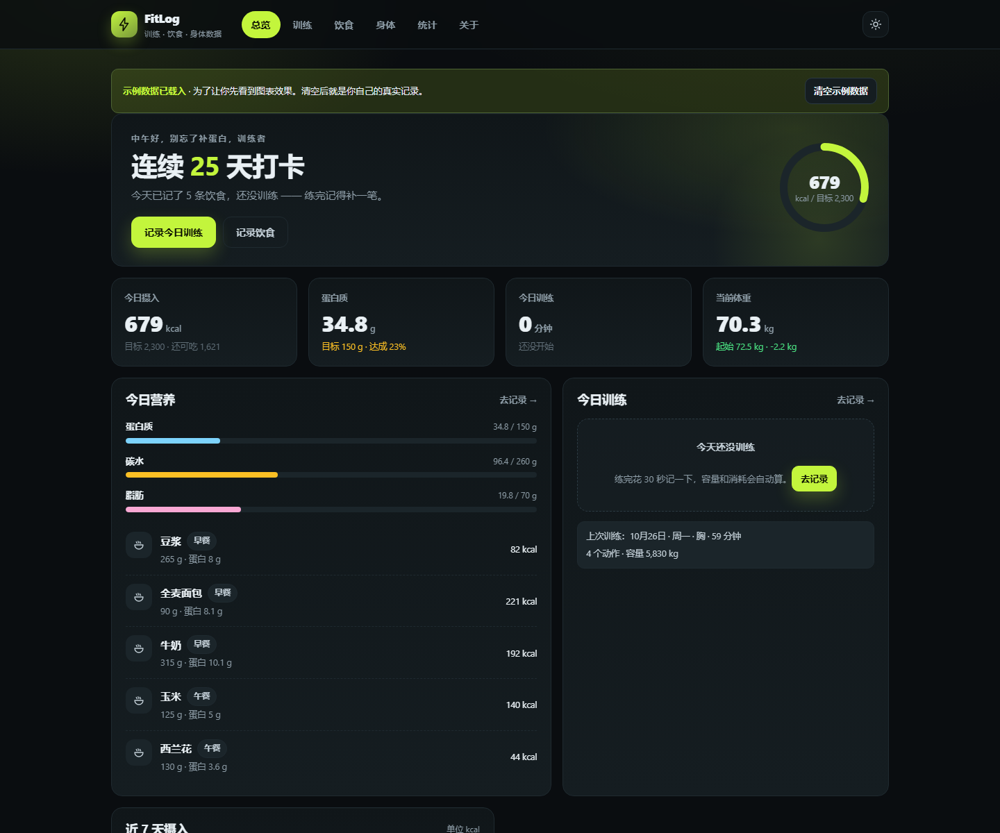
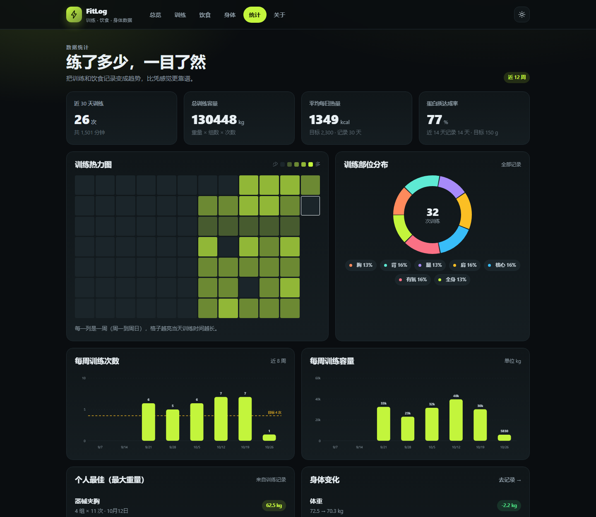
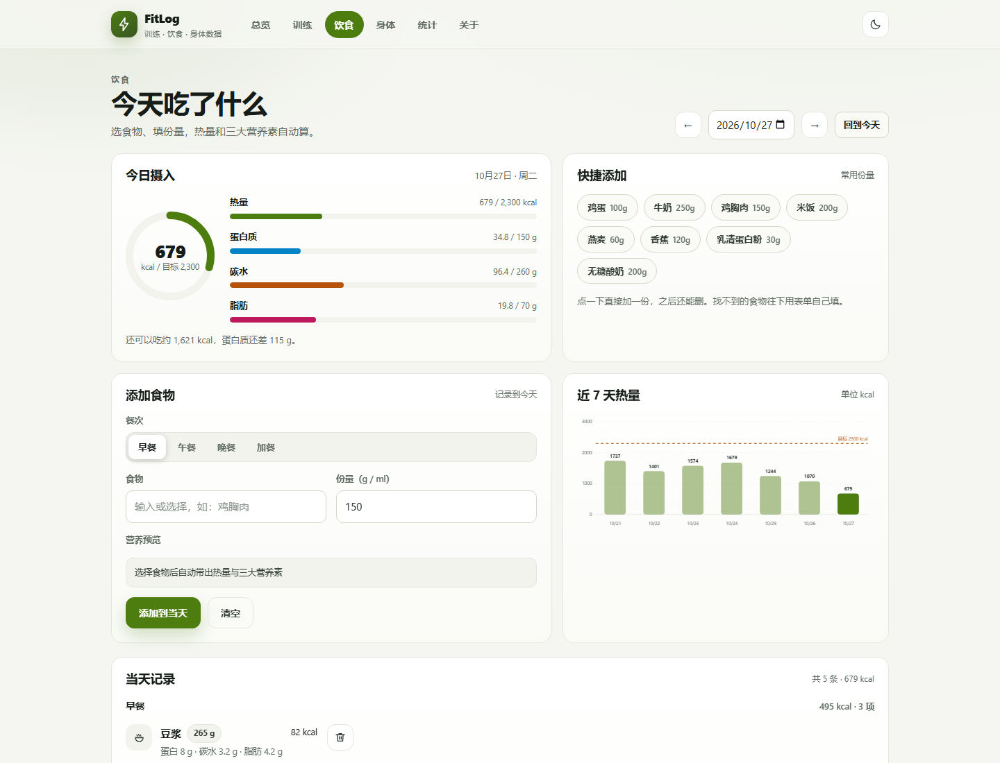

# FitLog · 训练日志

一个纯前端的健身记录网站：记录每天的训练、饮食和身体数据，用图表看趋势。
不需要安装环境、不需要联网，**双击 `index.html` 就能用**。

**在线访问**：<https://kysr04.github.io/fitlog/>

> 所有数据保存在你本机浏览器的 localStorage 里，不会上传到任何服务器。

## 界面预览

| 总览（深色） | 统计（深色） |
| --- | --- |
|  |  |

| 饮食（浅色主题） |
| --- |
|  |

> 首次打开会自动载入一份示例数据，所以图表不会是空的；不想要就在首页顶部或「关于」里清空。

---

## 一、六个页面

| 页面 | 文件 | 能做什么 |
| --- | --- | --- |
| 总览 | `index.html` | 今日热量 / 蛋白质 / 训练 / 体重概览，环形进度、7 天摄入柱状图、体重趋势、自动生成的今日建议、最近记录 |
| 训练 | `train.html` | 选部位、填动作 / 重量 / 组数 / 次数 / 时长 / 强度，自动算容量与消耗，模板一键填充，按日期分组的历史记录，近 6 周容量图 |
| 饮食 | `diet.html` | 按日期和餐次记录食物，按份量自动算热量与三大营养素，快捷添加常用食物，未收录食物可手动填，当日汇总与 7 天热量图 |
| 身体 | `body.html` | 记录体重 / 体脂，体重趋势图（30 天 / 90 天 / 全部）、BMI、距目标体重，记录列表可删除 |
| 统计 | `stats.html` | 12 周训练热力图、部位分布甜甜圈、每周次数与容量、个人最佳重量、身体变化汇总 |
| 关于 | `about.html` | 目标设置（身高 / 体重 / 热量 / 蛋白质 / 碳水 / 脂肪 / 每周次数），数据导出、导入、载入示例、清空 |

---

## 二、目录结构

```
健身记录/
├── index.html           总览
├── train.html           训练
├── diet.html            饮食
├── body.html            身体数据
├── stats.html           统计
├── about.html           关于 / 数据管理
├── css/
│   └── style.css        全站样式（深色 + 浅色主题、响应式、动画）
├── js/
│   ├── data.js          静态资料：8 个部位、45 个动作、4 套模板、28 种食物
│   ├── store.js         数据层：localStorage 读写、统计计算、示例数据、导入导出
│   ├── ui.js            界面外壳：导航 / 页脚 / 主题切换 / Toast / 弹窗 / 数字动画
│   ├── charts.js        手写 SVG 图表：环形、折线、柱状、甜甜圈、热力图
│   ├── page-home.js     各页面自己的逻辑
│   ├── page-train.js
│   ├── page-diet.js
│   ├── page-body.js
│   ├── page-stats.js
│   └── page-about.js
└── README.md
```

---

## 三、怎么打开

**方式一（最简单）**：双击 `index.html`，用 Chrome / Edge 打开。

**方式二（如果浏览器限制了本地存储）**：在本目录打开命令行，执行

```
python -m http.server 8000
```

然后浏览器访问 <http://127.0.0.1:8000/>。

> 用 `file://` 双击打开时，Chrome / Edge 一般允许 localStorage；如果发现记录存不住，
> 换成方式二即可。所有页面之间的跳转都是相对路径，换个文件夹也能正常打开。

---

## 四、数据说明

- 存储键名：`fitlog.v1`
- 首次打开会自动生成一份**示例数据**（约 5 周训练 / 饮食 / 体重），方便直接看到图表效果。
  在首页顶部或「关于」页可以一键清空，之后记录的就是你自己的真实数据。
- 「关于」页支持**导出 JSON 备份**和**从 JSON 恢复**。换电脑、换浏览器、清理浏览器数据前，
  记得先导出一份。
- 导入的文件结构：`{ "app": "FitLog", "version": 1, "data": { settings, workouts, meals, body } }`

---

## 五、用到的技术

- **HTML5**：语义化标签（`header` / `nav` / `main` / `section` / `article` / `footer`），六页共用同一套外壳。
- **CSS3**：CSS 变量做深 / 浅色双主题；Flex + Grid 布局；`color-mix()` 派生半透明色；
  卡片悬浮、淡入、进度条与环形进度的过渡动画；`prefers-reduced-motion` 降级；三档响应式断点。
- **原生 JavaScript（ES6+）**：模块用 IIFE 封装；localStorage 持久化；
  数组 `filter` / `sort` / `reduce` 做统计；`Intl` 风格的数字格式化；事件委托；防抖；`FileReader` 导入导出。
- **手写 SVG 图表**：环形进度（`stroke-dasharray`）、折线（路径 + 渐变面积）、柱状图、
  甜甜圈、热力图，全部不依赖图表库；颜色用 CSS 变量，切主题时图表自动跟着变。
- **无构建、无框架、无外部请求**：没有 CDN、没有字体文件、没有图片文件，断网也能完整使用。

---

## 六、想改哪里

- **改目标**：打开「关于」页，热量、蛋白质、碳水、脂肪、每周训练次数都能改。
- **加动作**：在 `js/data.js` 的 `EXERCISES` 里加一行 `{ name: '动作名', type: 'chest' }`。
- **加食物**：在 `js/data.js` 的 `FOODS` 里加一条（每 100g 的热量和三大营养素 + 常用份量）。
- **加模板**：在 `js/data.js` 的 `TEMPLATES` 里加一项，训练页会自动出现。
- **改配色**：`css/style.css` 顶部 `:root` 和 `html[data-theme="light"]` 里的 `--brand` 等变量，全站一起变。

---

## 七、已知限制

- 纯前端，没有账号和后端；数据只存在当前浏览器，换设备需要手动导入导出的 JSON。
- 热量消耗按「时长 × 强度系数」估算，不是医学级精度，只用于看趋势。
- 食物营养数据取自常见公开值，不同品牌会有差异，介意的话手动填。
- 未做训练计划提醒、组间计时器、图片上传等进阶功能。
